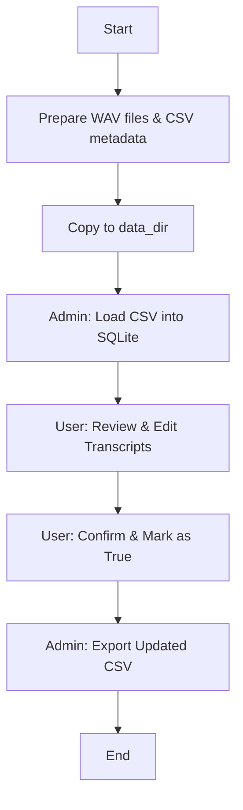

# Toucan-Giant 🦜

Toucan-Giant is a web-based tool built with Django for managing, editing, and verifying transcriptions of audio files (`.wav`). It provides an efficient interface for human-in-the-loop transcript correction and integrates with Google Cloud Speech services for Text-to-Speech (TTS) and Speech-to-Text (STT).

---

## 📋 Table of Contents
1. [Key Features](#-key-features)
2. [Project Workflow](#-project-workflow)
3. [Installation & Setup](#-installation--setup)
4. [Usage Guide](#-usage-guide)
    - [Wave Text Editor](#wave-text-editor)
    - [Admin Panel](#admin-panel)
5. [Google Cloud Integration](#-google-cloud-integration)
6. [Developer Resources](#-developer-resources)

---

## ✨ Key Features
- **Transcript Correction**: Simple web interface to edit raw transcripts while listening to the corresponding audio.
- **Batch Processing**: Import/Export large datasets via CSV files.
- **Verification Workflow**: Mark transcripts as verified/modified to track progress.
- **Google Cloud Speech**: Integrated TTS and STT capabilities.
- **Admin Dashboard**: Comprehensive control over database records and file management.

---

## 🔄 Project Workflow



---

## ⚙️ Installation & Setup

### Prerequisites
- Python 3.x
- Conda (Recommended)
- Google Cloud Service Account Key (for Speech features)

### Step-by-Step Setup
1. **Clone the repository**:
   ```bash
   git clone https://github.com/your-repo/Toucan-Giant.git
   cd Toucan-Giant
   ```

2. **Create and activate Conda environment**:
   ```bash
   conda create -n job_manager python=3.7
   conda activate job_manager
   ```

3. **Install dependencies**:
   ```bash
   pip install -r requirements.txt
   ```

4. **Prepare Data Directory**:
   Ensure a directory named `data_dir` exists in the root (or as configured in `settings.py`). This is where `.wav` and `.csv` files should be placed.

5. **Run Migrations**:
   ```bash
   python manage.py migrate
   ```

---

## 🚀 Usage Guide

### Running the Server
```bash
python manage.py runserver 0.0.0.0:8000
```
Access the application at `http://localhost:8000` or the server's IP (e.g., `20.20.1.188:8000`).

### Wave Text Editor
1. Select **'Wave text editor'** from the navigation.
2. You will see a list of audio files and their transcripts.
3. Click the **Edit icon** (pencil) next to the "Before Normalization" text.
4. Listen to the audio and adjust the text as needed.
5. Click the **Save/Confirm** button (red button) once verified.
6. The status will change from `False` to `True`.

### Admin Panel
Access at: `/admin/` (Default Login: `nvidia` / `nvidia`)

- **Pliki CSV (CSV Files)**:
    - Add the path to your source CSV file here.
    - **Fill Database**: Populates SQLite from the specified CSV.
    - **Generate CSV**: Exports current database records to a new CSV file (`updated_metadata_m_full.csv`).
- **Teksty w plikach wave**: View and manage individual database records.

---

## ☁️ Google Cloud Integration

The project uses Google Cloud APIs for speech processing. 

1. **Credentials**: Place your service account JSON key in the `data_dir` folder.
2. **Configuration**: The path is set in `filemanager/settings.py`:
   ```python
   os.environ['GOOGLE_APPLICATION_CREDENTIALS'] = os.path.join(MEDIA_ROOT, 'your-key.json')
   ```
3. **Features**:
   - **TTS**: Generate audio from text input.
   - **STT**: Automatically transcribe existing `.wav` files.

---

## 🛠 Developer Resources
For detailed technical information, including data models and API endpoints, please refer to the [Developer Guide](DEVELOPER_GUIDE.md).

---

## 🏁 Ending Work
1. Stop the server: `Ctrl + C`
2. Deactivate environment: `conda deactivate`
  
